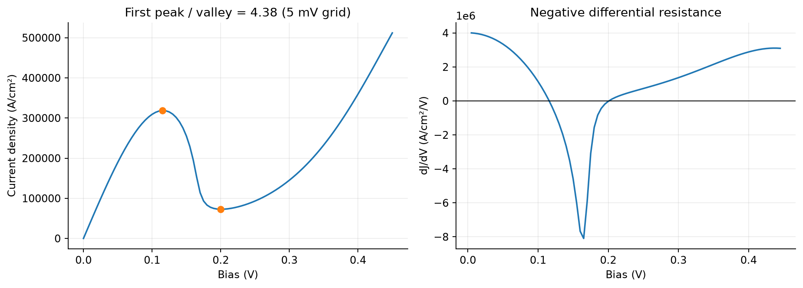
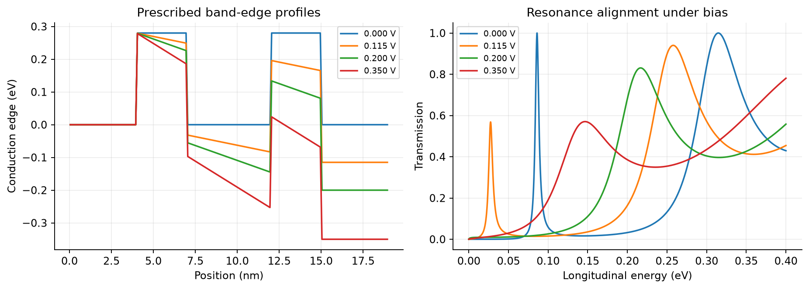
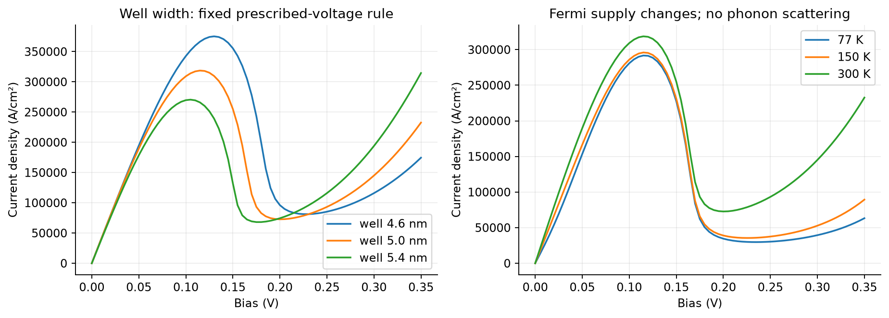
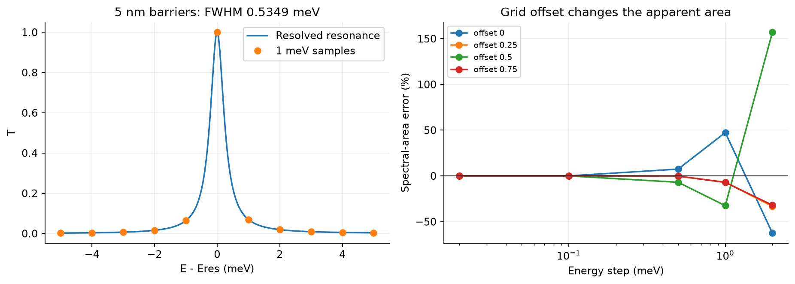

# mini-tcad-negf-rtd

**开放量子系统中的共振隧穿：电流为什么会随电压增大而下降，以及数值计算怎样会骗过我们。**

这是第六个教学型 TCAD（Technology Computer-Aided Design，工艺与器件计算机辅助设计）项目，接在 [薛定谔–泊松平衡量子模型](https://github.com/carveself/mini-tcad-schrodinger-poisson)之后。这里进入有左右两个电子库、非零偏压和电流的开放系统。

RTD（Resonant Tunneling Diode，共振隧穿二极管）由两个势垒与中间量子阱组成；电子能量与阱内准束缚态对齐时，透射增强。NEGF（Non-Equilibrium Green’s Function，非平衡格林函数）在本项目中用于引入无限长接触、计算透射与接触分辨局域谱。采用稳态、相干、弹道的单带模型，**电势由外部指定，不做 NEGF–Poisson 电荷自洽**。



## 一键运行

Python 3.10 或更新版本：

```bash
git clone https://github.com/carveself/mini-tcad-negf-rtd.git
cd mini-tcad-negf-rtd
python -m venv .venv
# macOS / Linux
source .venv/bin/activate
# Windows PowerShell 使用 .venv\Scripts\Activate.ps1
python -m pip install -r requirements.txt
python run_all.py
python -m unittest discover -s tests -v
```

默认不弹出绘图窗口，自动保存 **8 张 PNG、12 个 CSV、1 个 NPZ、1 个 JSON**。`figures/` 内同名文件会覆盖；另存复现结果可用：

```bash
python run_all.py --output reproduction/full
python src/stages.py baseline --output reproduction/01-baseline
python src/stages.py verify --output reproduction/02-verify
python src/stages.py sampling --output reproduction/03-sampling
python src/stages.py sensitivity --output reproduction/04-sensitivity
```

相对输出路径相对于执行命令的目录。测试和完整流程已在 Python 3.12、NumPy 2.3.5、SciPy 1.18.1、Matplotlib 3.11.2 实际运行。

## 三个研究问题

1. **电流下降是否对应共振能量离开有效注入窗口？** 比较偏压下能带、透射谱、三维电子库供给和 I–V，而不是仅看一条共振曲线。
2. **一张平滑曲线是否意味着算对了？** 用相同能窗、不同能量步长和网格起点，展示窄峰谱面积的失真；同时独立细化空间网格、能量积分和偏压网格。
3. **器件尺寸改变会影响什么？** 对比量子阱厚度对峰值位置与电流的影响、势垒厚度对共振线宽的影响，以及温度对费米供给的影响。

## 新概念与用途

| 名词 | 英文全称、中文含义及用途 |
|---|---|
| Retarded Green function | 推迟格林函数；描述开放边界的电子传播响应 |
| Contact self-energy | 接触自能；把无限接触对有限器件的作用写入端点矩阵 |
| Broadening | 展宽；由接触自能虚部给出逃逸通道，不能随意添加虚数来代替 |
| LDOS | Local Density of States，局域态密度；显示电子态集中在哪个位置和能量 |
| Injectivity | 注入态密度；区分左、右接触对局域谱的贡献，不等于已占据电子密度 |
| NDR | Negative Differential Resistance，负微分电阻；在这里指 dJ/dV<0 的区间 |
| PVR | Peak-to-Valley Ratio，峰谷比；取第一处内部电流峰与其后第一处谷的比值 |
| FWHM | Full Width at Half Maximum，半高全宽；这里以透射峰半高交点估算线宽 |
| S matrix | Scattering Matrix，散射矩阵；用连续薛定谔方程的分段散射级联作独立参考 |
| Tsu–Esaki formula | Tsu–Esaki 电流密度公式；将二维横向动量积分后，连接纵向透射与三维电子库电流 |

## 默认器件与电压约定

结构为 `4 nm spacer / 3 nm barrier / 5 nm well / 3 nm barrier / 4 nm spacer`。势垒高 0.28 eV，全域固定有效质量 0.067m₀，单能谷、自旋二重，300 K，空间网格 0.1 nm。左右接触分别无限延伸。该参数为 GaAs 风格的教学近似，**不是给定组分的真实 GaAs/AlGaAs 工艺标定**，没有质量跳变或非抛物性。

左接触导带与化学势为 0 和 0.08 eV；右端为 −V 和 0.08−V eV。偏压只在线性指定的双势垒活动区内下降，外侧间隔层平坦。接触简并程度保持相同，不从掺杂电中性反推化学势。

报告的 J 正号定义为 `q × 从左向右的净电子数通量`，q 为正的元电荷。若严格按电子负电荷和 +x 方向定义电荷电流，符号相反；这里 PVR、NDR 均沿上述输运符号约定。



## 已运行的关键结果

| 量 | 默认结果，约值 |
|---|---:|
| 5 mV 偏压网格的第一处峰/谷 | 0.115 / 0.200 V |
| 峰/谷电流密度 | 3.1863e5 / 7.2724e4 A/cm² |
| PVR | 4.3814 |
| 局部 1 mV 偏压细化的峰/谷、PVR | 0.116 / 0.201 V、4.3821 |
| 零偏压最低透射共振 | 0.0860375 eV |
| 3 nm 势垒的透射半高全宽 | 5.4927 meV |
| 5 nm 势垒的透射半高全宽 | 0.53487 meV |
| 0.1 V 电流：自适应 Gauss / 独立 QUADPACK 相对差 | 约 1.4e−8 |

负微分区间之后电流会再次上升。程序取第一处内部峰、随后第一处内部谷，不把扫描右端点最大值误报为共振峰。PVR 是该模型和扫描区间的结果，不是拟合某篇实验论文的指标。

4.6、5.0、5.4 nm 阱宽的第一处峰分别约在 0.130、0.115、0.105 V；峰电流也改变。改变阱宽时活动区总长度随之改变，固定的是同一端电压下降规则，**并非固定局部电场**。这些是离散尺寸情景比较，不是统计良率预测。



## 数值陷阱：网格起点也能改变结果

5 nm 势垒仍可在对称、无损零偏压结构中得到接近 1 的峰顶，但峰更窄。在最低共振周围固定 ±5 meV 的同一能窗，1 meV 均匀采样、四种起点给出的透射谱面积误差约为 **+47%、−7%、−33%、−7%**。这是谱面积，不是完整 I–V 电流；参照值由显式加入峰附近分点的独立自适应积分得到。



完整电流使用配对 8/16 点 Gauss 面板与自适应细分，初始面板宽度也单独减半复核。配对误差一致本身不能保证没有漏峰；该演示正是为什么还要做分辨率与独立积分检查。

## 可信度来自哪些证据

- 均匀匹配链 T=1；接触自能选取因果支，未加人为吸收、未裁剪 T。
- 不同能量/偏压下 R+T=1，检查左、右注入的每个键通量一致，局域谱满足 `A=GΓG†=i(G−G†)`。
- 递归格林函数与独立带状线性求解器一致：验证同一离散方程的求解。
- 连续散射级联先对照单矩形势垒解析公式，再检查零偏压双势垒谱的二阶空间收敛：验证差分与连续参考的关系。
- 独立 QUADPACK 积分、初始能量面板细化、能量尾部上界、偏压网格细化分别检查。
- 18 项测试覆盖以上内容及规范平移、偏压反转、平衡零电流和输入检查。

这些验证不是实验验证。连续参考仅对零偏压分段常数势做了比较；有限偏压电流的空间收敛由差分网格实验检查。尾部误差界只约束所声明有效质量供给模型中的能量截断，不覆盖材料模型误差。

## 按顺序复现

- [复现路线](docs/REPRODUCE.md)：从透明链到共振、NDR、数值失败和自己的扩展。
- [方程和单位](docs/MODEL.md)：接触自能、递归、三维供给、电流系数与谱量定义。
- [验证记录](docs/VALIDATION.md)：各项参考能证明什么、不能证明什么。
- [项目报告](docs/REPORT.md)：问题、方法、结果和局限。
- [英文简介与复试追问](docs/INTERVIEW.md)：训练讲解、推导与诚实描述个人贡献。
- [图和原始数据索引](figures/README.md)。

模型没有 Poisson 电荷反馈、散射/退相干、非弹性声子、有限接触串联电阻、自热、原子结构、异质结质量跳变、实验掺杂剖面或交流响应。因此不预测真实 RTD 的滞回、频率极限和实验 PVR。77/150/300 K 比较只改变电子库费米供给，不模拟温度依赖的散射和带边。

代码、数据和文档由工具辅助生成；复现时记录你独立推导、重写、排错和扩展的内容。值得展示的成果是你能提出问题并验证解释，而不是把下载的参考结果称为独立完成的实验。

## 参考资料

- [TU Wien：共振隧穿二极管的开放态、能级对齐与峰谷指标](https://www.iue.tuwien.ac.at/phd/kosik/node64.html)。
- [TU Wien：Tsu–Esaki 公式的横向动量积分推导](https://iue.tuwien.ac.at/phd/gehring/node36.html)。
- [Tkwant：格林函数与半无限链的解析表面格林函数](https://tkwant.kwant-project.org/doc/dev/tutorial/green_functions.html)。
- [Kwant 原始方法论文](https://arxiv.org/abs/1309.2926)：散射与格林函数量子输运框架。本项目不依赖 Kwant，也不声称已经与 Kwant 软件输出交叉运行。
